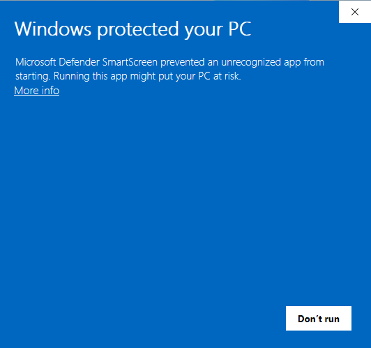
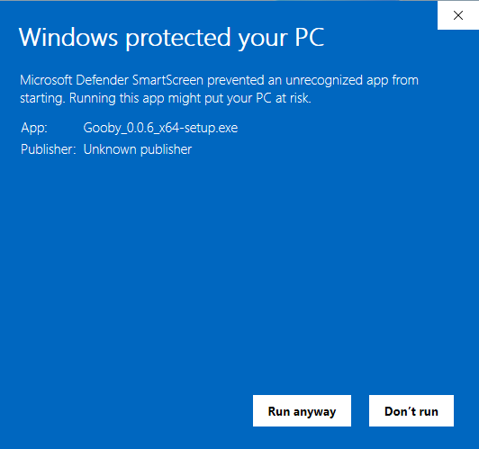

# Installing Gooby

Gooby is in alpha and isn't signed yet, so your computer will ask whether you
trust it the first time you open it. That's expected. Here's what to click.

You only do this once. After that, Gooby updates itself from inside the app,
and updates don't ask again.

- [Windows](#windows)
- [macOS](#macos)
- [Linux](#linux)
- [Why isn't Gooby signed?](#why-isnt-gooby-signed)

Download the installer from [heygooby.com](https://heygooby.com/#download) or
the [latest release](https://github.com/gooby-app/releases/releases/latest).

## Windows

Windows 10 and 11, 64-bit. You don't need an administrator password: Gooby
installs just for you.

1. Open `Gooby_x.y.z_x64-setup.exe` from your downloads.
2. Windows shows **"Windows protected your PC"**. Click **More info**.

   

3. Click **Run anyway**.

   

4. The installer opens. Keep **Normal Installation**, click **Next** through
   to **Finish**, and Gooby opens and sets itself up. It downloads its models
   once (2 to 4 GB).

**"Smart App Control blocked an app"** instead, with no Run anyway? Smart
App Control is a Windows setting that blocks every app that isn't signed, and
it can't make an exception for one app. You can turn it off in **Windows
Security → App & browser control → Smart App Control settings**. If you'd
rather keep it on, Gooby can't run on that PC until it's signed.

**Your antivirus removed the file?** New apps that aren't signed sometimes get
flagged. Please don't turn your antivirus off; tell us in
[Discord](https://heygooby.com/discord) or an
[issue](https://github.com/gooby-app/releases/issues) which antivirus it was.

## macOS

macOS 13.3 (Ventura) or later on a Mac with Apple Silicon (M1 and newer).
Gooby doesn't run on Intel Macs: Apple menu → About This Mac shows a **Chip** (Apple M1 or
later) on the Macs it runs on, and a **Processor** (Intel) on the others.

1. Open the `.dmg` and drag **Gooby** into **Applications**. Open it from
   Applications, not from the disk image: it can only update itself there.
   (If you forget, Gooby offers to move itself.)
2. macOS says **"Apple could not verify 'Gooby' is free of malware"**. Click
   **Done** (not Move to Trash).
3. Open **System Settings → Privacy & Security** and scroll down to Security.
   Next to "Gooby was blocked", click **Open Anyway**.
4. macOS asks once more: click **Open Anyway** and enter your password. Gooby
   opens and sets itself up. It downloads its models once (2 to 4 GB).
5. Allow what Gooby asks for: **Microphone**, and **Accessibility** so it can
   type for you.

Right-click → Open no longer skips this on macOS 15 Sequoia and later; the
Privacy & Security step is the way.

**macOS says Gooby "is damaged and can't be opened"?** It isn't. Something
removed the information macOS checks, usually a download manager or an archive
tool. Download it again with Safari or Chrome. If it still says so, tell us in
[Discord](https://heygooby.com/discord).

## Linux

No warnings on Linux. One command installs Gooby just for you, with an
app-menu entry, in a place where updates can replace it (no sudo):

```bash
curl -fsSL https://raw.githubusercontent.com/gooby-app/releases/main/install-linux.sh | bash
```

Or install a file yourself:

- **AppImage** (Ubuntu 24.04, Debian 13, Fedora 39 or newer): make it
  executable, then open it. In a terminal, `chmod +x Gooby_*.AppImage`; in
  most file managers, right-click → Properties → Allow executing. If it won't
  start, install FUSE (`sudo apt install fuse3`), or use the command above,
  which works without it.
- **.deb** (Ubuntu 22.04, Debian 12 and systems built on them, such as Linux
  Mint 21): `sudo apt install ./Gooby_x.y.z_amd64.deb`. Updates ask for your
  password each time, since they install a package. If you cancel, Gooby
  tells you how to install the new version yourself.

## Why isn't Gooby signed?

Signing certificates cost money every year, and Gooby is free while it's in
alpha. Signing tells your computer who made an app; without it, your computer
can't tell, so it asks you.

What keeps you safe instead:

- Every installer is published only on
  [gooby-app/releases](https://github.com/gooby-app/releases/releases) (and
  heygooby.com links there). Each release has a `SHA256SUMS` file, so you can
  check your download matches; the release notes say how.
- Updates are signed with Gooby's own key, and Gooby refuses any update that
  isn't.
- Gooby works offline. See [PRIVACY.md](PRIVACY.md) for everything it stores
  and every connection it can make.

Questions? Ask in [Discord](https://heygooby.com/discord), or see
[SUPPORT.md](SUPPORT.md).
