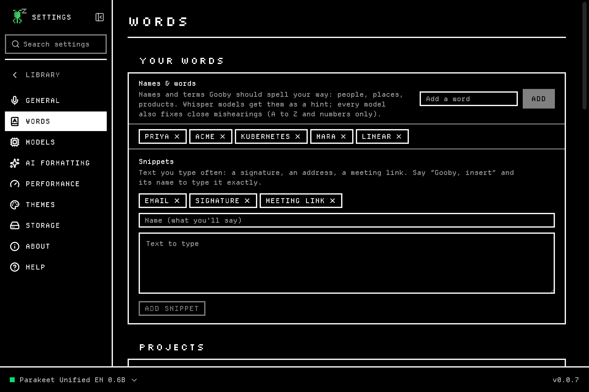
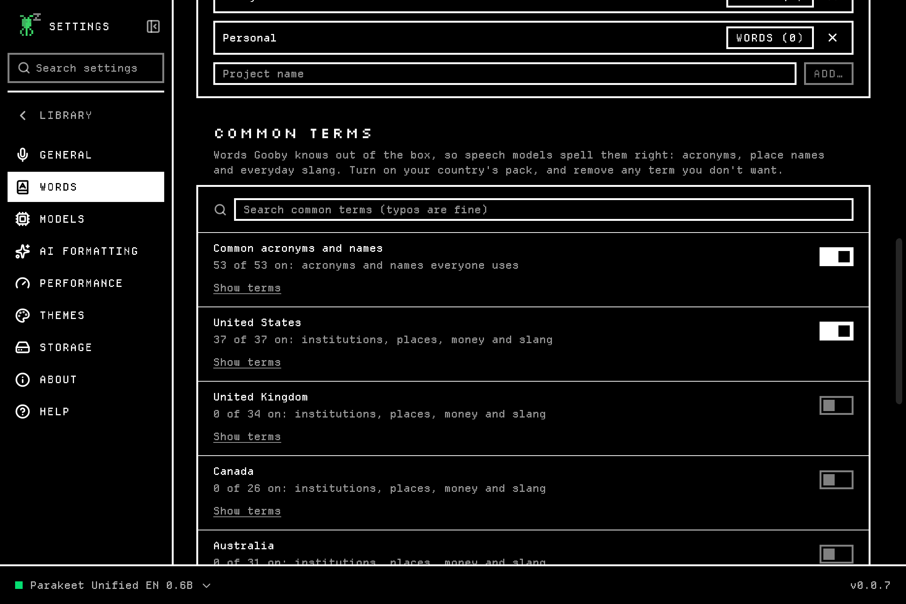

<p align="center">
  
</p>

<p align="center">
  
  
  
  
  
</p>

<p align="center">
  <a href="https://heygooby.com/download/windows"></a>
  <a href="https://heygooby.com/download/mac-arm"></a>
  <a href="#linux"></a>
</p>

<p align="center">
  <a href="#what-gooby-does">Features</a> ·
  <a href="#download">Download</a> ·
  <a href="#getting-started">Getting started</a> ·
  <a href="#faq">FAQ</a> ·
  <a href="CHANGELOG.md">What's new</a> ·
  <a href="PRIVACY.md">Privacy policy</a> ·
  <a href="LICENSE.md">License</a> ·
  <a href="TROUBLESHOOTING.md">Help</a>
</p>

> [!NOTE]
> Gooby is in **alpha**: v0.0.7 is the first version for people outside the
> team. It's free to use, and it will have rough edges; please
> [tell us](#help-and-feedback) what you find. Testing it for us?
> [TESTER-GUIDE.md](TESTER-GUIDE.md) walks you through it. Click **Watch →
> Custom → Releases** at the top of this page to hear about new versions.

Gooby turns your voice into text in any app, and does it all on your own
computer. Press a shortcut, talk, press it again, and clean, punctuated text
appears where your cursor is: an email, a document, a chat, a code editor.
Speech recognition and AI formatting run locally, so what you say never
leaves your computer, and there's no account to make and no per-minute
pricing.

<p align="center">
  
  <br>
  <sub>A real dictation into an email, recorded on Linux (the voice is text-to-speech). The overlay at the top<br>shows Gooby listening; the AI formatter turned the spoken steps into a numbered list.</sub>
</p>

## What Gooby does

- **Dictate into any app.** One shortcut, in any app that takes text. Hold it
  to talk, or tap to start and tap to stop. Or say "Hey Gooby" (experimental).
- **Private by design.** Speech and formatting run on your computer. No
  account, no tracking, no cloud unless you turn it on.
- **Clean text, not a transcript.** A local AI model fixes punctuation,
  drops the "um"s, turns spoken lists into real lists and fits the app you're
  typing into.
- **Talk to Gooby.** Start with "Gooby, …" to rewrite selected text, keep a
  note to self, insert a snippet, or switch language, project or style.
- **Your words.** Names, jargon and your country's common terms, spelled your
  way.
- **A Library of everything you've said.** Every dictation with its audio:
  search it, star it, file it in projects and tags, see it on a calendar.
- **Set up in one click.** Gooby picks the speech model and AI formatter that
  suit your computer and finds your microphone.
- **Yours to style.** Light or dark, six two-color palettes, four overlay
  looks, and text from Small to Largest.

### Dictate into any app

Put your cursor where the text should go, press **Ctrl+Alt+Space**
(**Option+Space** on a Mac) and speak. A small overlay shows Gooby listening;
press the shortcut again, or let go if you held it, and your words are typed
in. **Esc** throws a dictation away (on Linux, end with "Gooby, cancel" or
use Cancel in the tray menu).

<p align="center">
  
</p>

- **Works where you type:** email, documents, chat, browsers, terminals, code
  editors. Gooby types the text for you or pastes it, whichever works best
  in that app, and puts your clipboard back afterwards.
- **Names and words** you teach it ("Priya", "Kubernetes", your company's
  products) are spelled your way.
- **Gooby shows what it's doing:** it swims like a jellyfish while you talk,
  thinks while it transcribes (counting the seconds if your computer takes a
  while), sparkles when the text is in and looks puzzled or sad when
  something didn't work.
- **Didn't hear anything?** The overlay says so instead of typing nothing,
  and if another app already holds the shortcut, Gooby picks a free one and
  tells you.
- **When typing isn't possible**, the text goes to the clipboard and the
  overlay tells you, so nothing you said is lost.

### Clean text, not a transcript

Gooby tidies what you said before it's typed: punctuation and capitals, no
"um"s or false starts, and lists when you speak in steps. Pick Gooby's own
formatting (Inky: fast, with nothing to set up) or an AI model that rewords
more: a model built into Gooby (Gemma or Qwen, picked for your computer),
or [Ollama](https://ollama.com) if you already have it.
Either way it runs on your computer, so nothing is sent anywhere. Settings →
AI formatting says which one formats your dictations right now, and "Gooby,
formatting off" types your words exactly as said.

<p align="center">
  
</p>

**It fits the app you're typing into:** paragraphs in an email, casual in a
chat, every detail kept in a prompt for an AI assistant, and in a terminal or
code editor your words exactly as said. Each recording in the Library shows
where it went ("Typed into Slack"). (Not on Wayland, where the desktop
doesn't say which app is in front.)

**Short dictations don't wait for the AI:** a few words are tidied by simple
rules ("question mark", "new line", a capital letter) and typed at once.

Prefer another model? Gooby also works with any OpenAI-compatible server on
your own computer (such as Ollama or LM Studio), Apple Intelligence on Macs,
and, only once you allow cloud providers, OpenAI, Anthropic, Groq, OpenRouter,
Cerebras, Z.AI and AWS Bedrock. API keys are kept in your system's password
store.

### Talk to Gooby

Start a dictation with "Gooby," to change things without opening Settings.
Anything Gooby doesn't recognize is typed as you said it.

<p align="center">
  
</p>

| Say | What happens |
|---|---|
| "Gooby, make this shorter" | With text selected in any app: rewrites it in place. "Fix the grammar", "translate this into French" and "format this" work too; Ctrl+Z (Cmd+Z) undoes it. |
| "Gooby, note: call the dentist" | Kept in the Library as a note to self; nothing is typed. "Note to self …" works too. |
| "… Gooby, cancel" | Throws this dictation away. "Never mind" and "scratch that" work too. |
| "Gooby, insert my signature" | Types a snippet you saved (a signature, an address, a meeting link) exactly. |
| "Gooby, SOAP note: …" | Formats what follows with your AI formatting prompt of that name, for this dictation only. |
| "Gooby, type that" | Types your last dictation where the cursor is. |
| "Gooby, formatting off" | Types your words exactly as said ("formatting on" goes back). "AI formatting on" or "off" switches between the AI and Inky. |
| "Gooby, what formatting are you using?" | Says who formats your dictations right now: Inky or the AI model, and why not the AI, if it isn't. |
| "Gooby, use the email style" | Formats with one of your styles; "the default style" goes back. |
| "Gooby, switch to French" | Dictate in another language; "auto-detect" goes back. |
| "Gooby, switch to the Acme project" | Files new dictations in Acme until "Gooby, no project". |
| "Gooby, sounds off" | Silences the start and stop sounds (or turns them on again). |
| "Gooby, stop typing" | Keeps dictations as notes in the Library until "start typing". |
| "Gooby, open the Library" | Opens Gooby ("open settings" opens Settings, "open storage settings" any page, "show me recently deleted" a Library view). |
| "Gooby, delete the last note" | Changes the Library by voice: delete, open, rename ("rename that to Q3 plan"), move ("move it to Acme"), star or bring back a recording. Say which: "the last note", "my note about pricing", or "that" for the one open in Gooby. When it isn't clear, Gooby asks instead of guessing; "Gooby, undo" takes it back. |
| "Gooby, what can I say?" | Opens this list in Settings → Help. |

Dictating while Gooby's own window is in front, with no text box selected,
keeps the dictation as a note too. Turn on **Don't type when there's nowhere to
type; keep a note instead** (Settings → General → Advanced; Linux and Windows) and the
same goes for any app: with a button, a list or the desktop in focus, what you
say is saved instead of lost. With the overlay turned off, what a command
did shows as a system notification.

#### "Hey Gooby" (experimental)

Turn on **"Hey Gooby"** (setup offers it; Settings → General or the tray menu
later) and say "Hey Gooby, …" instead of pressing the shortcut: what follows
is typed, or done if it's a command ("Hey Gooby, make this shorter"). Gooby
stops when you pause. A small model on your computer listens for its name,
holding only the last second and a half of sound in memory, and the tray icon
shows a blue dot while it does. It's off unless you turn it on, and still
experimental: it misses some voices and can wake on similar phrases.

### Your words

Settings → Words teaches Gooby how you spell things:

- **Names & words**: "Priya", "Kubernetes", your company's products.
- **Common terms**: packs of acronyms (FBI, GDPR…) and, for the US, UK,
  Canada, Australia, New Zealand, Ireland, India and South Africa, the
  institutions, places, money and everyday slang that speech models often
  miss, plus Hindi and Tagalog words for mixed-language speech. Setup turns on
  your country's pack.
- **Words for each project**: a book's characters or a client's products,
  used while that project is active.
- **Snippets**: text you'd rather not dictate ("Gooby, insert my email").

| Names, words and snippets | Common terms |
|---|---|
|  |  |

### A Library of everything you've said

Every dictation is kept with its audio, so nothing you said is lost, even if
the app you were typing into wasn't ready.

<p align="center">
  
</p>

- **Projects, nested tags** (`work/acme`), **favorites** and **notes to
  self**, plus Unsorted and Recently Deleted (kept until you empty it).
- **Say where it goes:** start with "For the Acme project: …" or end with
  "… put it in Acme", and it's filed there with the command cut from the text.
- **Summaries:** while Gooby is idle, your AI formatter gives each
  recording a title, a short summary and its action items, and suggests tags
  and a project for one click. Your own title, tags and project are never
  changed. On your computer by default; a cloud provider only if you say so.
- **Search** across titles, transcripts, notes and summaries; **drag and drop**
  recordings onto a project or tag, select several at once, and undo mistakes.
  Right-click a recording to rename or tag it.
- **Live transcript:** words light up as the audio plays. Click one to jump
  there, fix mistakes in place, and "Teach Gooby" the right spelling.
- **Notes** on any recording, saved as you type.

| Calendar | Notes to self |
|---|---|
|  |  |

### Set up in one click

The first screen asks which language you'll speak and shows the speech model
and microphone Gooby picked for your computer. Gooby's own formatting (Inky)
tidies your words from the first dictation, with nothing else to install or
choose; AI models are one click each in Settings → AI formatting, when you
want them. Your name and email (optional) become snippets, and "Hey Gooby" is
offered, unticked. One click downloads the speech model, and you can dictate
as soon as it's ready.

<p align="center">
  
</p>

If your system's default input can't hear a voice (a digital S/PDIF input, a
loopback), Gooby switches to a real microphone and tells you. A microphone you
chose yourself always wins.

### The right model for your computer

Gooby rates every speech model for your memory and graphics card ("great",
"may be slow", "too large") and recommends the most accurate one that runs
well and speaks your language. Models use your graphics card when they can
(Vulkan on Windows and Linux, Metal on Macs) and your processor otherwise.

<p align="center">
  
</p>

<details>
<summary><b>Speech models you can choose from</b></summary>

<br>

| Family | Good at | Languages | Download |
|---|---|---|---|
| **Parakeet** (NVIDIA) | Fast and accurate English; v3 covers 25 European languages | 1–25 | 130 MB – 890 MB |
| **Whisper** (OpenAI) | The widest language coverage | up to 100 | 44 MB – 1.5 GB |
| **Cohere Transcribe** | Top accuracy | 2–14 | 1.7 GB |
| **Canary** (NVIDIA) | Accurate and quick in English, German, Spanish and French | 1–25 | 145 MB – 1.8 GB |
| **Qwen3-ASR** | Many languages, including Chinese | 30 | 810 MB – 1.4 GB |
| **Nemotron Streaming** (NVIDIA) | Live, in English or 28 languages | 1–28 | 700 MB |
| **SenseVoice** | Chinese, Cantonese, Japanese, Korean, English | 5 | 150 MB – 240 MB |
| **Moonshine** | Tiny and very fast, for older computers | 1 each | 31 MB – 280 MB |
| **Granite Speech** (IBM), **Voxtral** (Mistral), **GigaAM** (Russian) and more | Specialists | varies | 120 MB – 16 GB |

Models are downloaded from their publishers (through Hugging Face or Handy's
mirror) and come with their own licenses.

</details>

<details>
<summary><b>AI formatting models</b></summary>

<br>

| Model | Download | Notes |
|---|---|---|
| Gemma 3 1B | 770 MB | English only, for computers without much memory |
| Qwen 2.5 1.5B | 1.0 GB | Many languages; the pick at setup without a graphics card |
| Gemma 3 4B | 2.3 GB | The pick at setup with a graphics card |
| Gemma 3 12B | 6.8 GB | Best results; Gooby recommends it when your graphics card has room |

Setup downloads at most the 2.3 GB model; bigger ones are opt-in.


</details>

### Make it yours

Light or dark (or follow your system), six two-color palettes that also color
the overlay, four overlay looks (Classic, Island, Soft and Pixel), and text
from Small to Largest (**Ctrl/Cmd +** and **−**) that follows your system's
text size on Windows and GNOME. Text is in Gooby's pixel font, drawn
pixel-perfect so it's sharp, or in your system's font if you prefer.

<p align="center">
  
</p>

| Themes | Settings |
|---|---|
|  |  |

## Privacy in short

What you say stays on your computer. There's no account and no tracking, and
we never receive your dictations, recordings or settings. We count
downloads, and, only if you say yes, update checks, without an ID.
Nothing that carries your words goes online unless you turn it on.

<p align="center">
  
</p>

| | Where it happens |
|---|---|
| Recording your voice | Your computer |
| "Hey Gooby" (if you turn it on) | Your computer; only the last 1.5 seconds, in memory |
| Speech to text | Your computer, with the model you picked |
| AI formatting | Your computer by default; a cloud provider only if you allow it and pick one |
| Your Library (text, audio, notes) | Files in Gooby's data folder on your computer |
| Model downloads | Hugging Face or Handy's mirror, only when you start one |
| Update checks | This page's releases, only if you said yes |
| Usage counts | heygooby.com counts update checks (version, system, install month; no ID), only if you said yes to that too |

The [Gooby privacy policy](PRIVACY.md) lists every connection, every file
Gooby keeps and your rights, and says how to reach us.

## Download

Download from [heygooby.com](https://heygooby.com/#download), or pick the file
for your system from the
[latest release](https://github.com/gooby-app/gooby-releases/releases/latest):

| Your computer | Needs | Download |
|---|---|---|
| **Windows** | Windows 10 or 11, 64-bit | [`Gooby_<version>_x64-setup.exe`](https://heygooby.com/download/windows) |
| **Mac** | Apple Silicon (M1 or newer), macOS 13.3 Ventura or later. Not Intel Macs | [`Gooby_<version>_aarch64.dmg`](https://heygooby.com/download/mac-arm) |
| **Linux** | Ubuntu 24.04, Debian 13, Fedora 39, Arch or newer, 64-bit | [`Gooby_<version>_amd64.AppImage`](https://heygooby.com/download/appimage), or the [one-command install](#linux) |
| **Linux** | Ubuntu 22.04, Debian 12, Linux Mint 21 and others built on them, 64-bit | [`Gooby_<version>_amd64.deb`](https://heygooby.com/download/deb) |

**Every system:** a microphone, and up to about 4 GB of disk space for the
models setup downloads. Gooby picks models that fit your memory, so it runs on
ordinary laptops; a graphics card makes it faster but isn't needed. On Linux,
X11 and Wayland both work.

**Checking a download:** each release has a `SHA256SUMS` file. Compare your
download with it: `sha256sum -c SHA256SUMS --ignore-missing` on Linux,
`shasum -a 256 -c SHA256SUMS --ignore-missing` on macOS, or `Get-FileHash
<file>` in PowerShell on Windows.

Gooby is in alpha and isn't signed yet, so Windows and macOS ask whether you
trust it the first time. [INSTALL.md](INSTALL.md) shows what to click, step by
step. After that, Gooby updates itself without asking again.

### Windows

Run the installer (no administrator password needed). At "Windows protected
your PC", click **More info → Run anyway**.

### macOS

Open the `.dmg` and drag Gooby to Applications. The first time, macOS stops
it: click **Done**, then **System Settings → Privacy & Security → Open
Anyway**.

### Linux

One command, no sudo. It installs Gooby just for you, with an app-menu entry
and a `gooby` command, in a place where updates can replace it:

```bash
curl -fsSL https://raw.githubusercontent.com/gooby-app/gooby-releases/main/install-linux.sh | bash
```

Or install the `.deb` with `sudo apt install ./Gooby_x.y.z_amd64.deb`, or make
the AppImage executable (`chmod +x`) and run it.

The one-command install and the AppImage need Ubuntu 24.04, Debian 13, Fedora
39 or newer (glibc 2.38). On Ubuntu 22.04, Debian 12 and systems built on them,
such as Linux Mint 21, use the `.deb`.

## Getting started

1. **Open Gooby.** The setup screen shows what it picked for your computer.
   Click **Set up Gooby**.
2. **Allow what your system asks for:**
   - **macOS:** Microphone, and Accessibility (so Gooby can type for you).
   - **Windows:** if nothing is recorded, check that **Settings → Privacy &
     security → Microphone** lets desktop apps use it.
   - **Linux on Wayland:** your desktop asks once to let Gooby type into other
     apps. On KDE Plasma, GNOME 48+ and Hyprland it also asks to confirm
     Gooby's shortcut; on older GNOME, Settings → General shows how to add it
     as a system shortcut.
3. **Click into any text box, press the shortcut and talk.** Press it again
   to stop.

| Shortcut | Windows and Linux | macOS |
|---|---|---|
| Start and stop dictating | Ctrl+Alt+Space | Option+Space |
| Edit the selected text by voice | the dictation shortcut, then "Gooby, make this shorter" | the same |
| Throw the current dictation away | Esc (Linux: "… Gooby, cancel") | Esc |
| Open or close Settings | Ctrl+, | Cmd+, |
| Search Settings | Ctrl+F | Cmd+F |
| Bigger, smaller, normal text | Ctrl + / − / 0 | Cmd + / − / 0 |

Every shortcut can be changed in Settings. Hold the dictation shortcut to talk
only while it's down, or tap it to start and stop; Settings → General can fix
it to one way.

## Updates

On first launch Gooby asks whether to keep itself up to date. If you say yes,
it downloads new versions in the background, checks their signature, and asks
before restarting (never mid-recording); "What's new" shows afterwards. If you
say no, nothing contacts the internet for updates, and you can download new
versions from this page.

## FAQ

<details>
<summary><b>Does Gooby work offline?</b></summary>

Yes. Once the models are downloaded, dictation and AI formatting work with no
internet connection at all.
</details>

<details>
<summary><b>Is my voice used to train anything?</b></summary>

No. Your audio and text stay in Gooby's folder on your computer. Gooby has no
servers to send them to and no account.
</details>

<details>
<summary><b>What does it cost?</b></summary>

Nothing. During the alpha and beta, Gooby is free for any purpose, personal or
work, under its [end-user license](LICENSE.md). Terms for later versions will
come with those versions.
</details>

<details>
<summary><b>Is "Hey Gooby" always listening?</b></summary>

Only if you turn it on; it's off by default. While it's on, the microphone
stays open and a small model on your computer listens for "Hey Gooby",
holding only the last second and a half of sound in memory. Nothing is saved
or sent until it hears its name. The tray icon shows a blue dot while it
listens, and the tray menu turns it off.
</details>

<details>
<summary><b>Do I need a graphics card?</b></summary>

No. Gooby rates every model for your computer and picks one that runs well on
what you have. A graphics card (NVIDIA, AMD or Intel through Vulkan, or any
Apple Silicon Mac) makes the bigger models fast.
</details>

<details>
<summary><b>Which languages does it understand?</b></summary>

Up to 100, depending on the speech model: Whisper covers the most, Parakeet v3
covers 25 European languages, and smaller models are English-only. Gooby's
recommendation takes your language into account. The app itself is translated
into 25 other languages; voice commands are English-only for now.
</details>

<details>
<summary><b>Does it work on Wayland?</b></summary>

Yes. Gooby types into native Wayland apps on GNOME and KDE through the desktop's
own remote-input permission (your desktop asks once), and registers its
shortcut with desktops that support it.
</details>

<details>
<summary><b>Can I use my own microphone or headset?</b></summary>

Yes. Gooby picks a real microphone at setup, and you can choose any input in
Settings. Your choice always wins over Gooby's pick.
</details>

<details>
<summary><b>Where are my recordings, and how do I delete them?</b></summary>

In Gooby's data folder (`~/.local/share/com.gooby.dictation` on Linux,
`%APPDATA%\com.gooby.dictation` on Windows, `~/Library/Application
Support/com.gooby.dictation` on macOS). Delete recordings in the Library, or
delete the folder to remove everything. Details in [PRIVACY.md](PRIVACY.md).
</details>

<details>
<summary><b>Why isn't the source code here?</b></summary>

Gooby's source code is private for now. This repository holds the installers,
release notes, user docs and the issue tracker. Gooby is built on open-source
software, credited below and in
[THIRD-PARTY-NOTICES.txt](THIRD-PARTY-NOTICES.txt).
</details>

## Coming next

Plans, not promises:

- **A second brain**: "what did I decide about pricing last week?" answered
  from your own Library, and a daily recap of your to-dos.
- **Meetings and long audio**: import audio and video files, who said what,
  and meeting notes.
- **More languages**: mixed-language dictation, and speak in one language,
  type in another.

Have an idea? [Suggest it](https://github.com/gooby-app/gooby-releases/issues/new?template=feature_request.yml).

## Uninstall

<details>
<summary><b>Windows, macOS and Linux</b></summary>

- **Windows:** Settings → Apps → Installed apps → Gooby → Uninstall. To
  remove your recordings, settings and models too, tick "Also delete my
  recordings, settings and downloaded models".
- **macOS:** Gooby → Settings → Storage → **Move Gooby to Trash**. It asks
  whether to keep your recordings, settings and models. (Dragging Gooby from
  Applications to the Trash works too, but keeps them.)
- **Linux:** if you used the one-command install,
  `curl -fsSL https://raw.githubusercontent.com/gooby-app/gooby-releases/main/install-linux.sh | bash -s -- --uninstall`.
  It asks whether to keep your data; `--purge` instead of `--uninstall`
  removes everything without asking. For the `.deb`, `sudo apt remove gooby`;
  for the AppImage, delete it.

To remove your data before uninstalling another way, use Settings → Storage →
**Remove all Gooby data**. [PRIVACY.md](PRIVACY.md) lists where everything is.
</details>

## Help and feedback

- **Something not working?** [TROUBLESHOOTING.md](TROUBLESHOOTING.md) covers
  known issues and fixes, and Settings → Help in the app has the common ones.
- **Found a bug?** [Report it](https://github.com/gooby-app/gooby-releases/issues/new?template=bug_report.yml).
  Settings → About → Log directory opens the folder with Gooby's logs;
  attaching the latest one helps a lot.
- **Have an idea?** [Suggest it](https://github.com/gooby-app/gooby-releases/issues/new?template=feature_request.yml).
- **Want to chat?** Join [Gooby's Discord](https://heygooby.com/discord) for
  questions, ideas and news (also in Settings → About).
- **Want to support Gooby?** [Buy me a coffee](https://buymeacoffee.com/heygooby),
  or [Razorpay](https://rzp.io/rzp/2BYxcWw) for UPI; Donate in Settings → About
  has both. Gooby stays free, with no ads, account or tracking.
- **Security problem?** Please report it privately, as [SECURITY.md](SECURITY.md)
  explains.
- **Testing the alpha?** [TESTER-GUIDE.md](TESTER-GUIDE.md) is the script,
  step by step for your system.
- **Anything else,** including privacy and legal questions:
  [hello@heygooby.com](mailto:hello@heygooby.com). [SUPPORT.md](SUPPORT.md)
  has all the ways to reach us.

## License

Gooby is free to use during the alpha and beta under its
[end-user license](LICENSE.md). Its source code is private.

Gooby includes open-source software; [THIRD-PARTY-NOTICES.txt](THIRD-PARTY-NOTICES.txt)
lists every component with its license, and the app shows the same list under
**Settings → About → Licenses**. Speech and formatting models are
downloaded from their publishers and come with their own licenses.

## Credits

- **[Handy](https://github.com/cjpais/Handy)** by CJ Pais (MIT): Gooby began
  as a fork of it.
- **[ggml](https://github.com/ggml-org/ggml)** and
  **[llama.cpp](https://github.com/ggml-org/llama.cpp)** by Georgi Gerganov and
  contributors, and **[ONNX Runtime](https://onnxruntime.ai)** by Microsoft run
  the models on your computer.
- **"Hey Gooby"** was trained with
  **[Hey Buddy!](https://github.com/painebenjamin/hey-buddy)** by Benjamin
  Paine (Apache 2.0), which also provides two of its models with Google's
  Speech Embedding model, on openly licensed speech, voices
  ([Piper](https://github.com/rhasspy/piper)), sounds and music credited in
  [THIRD-PARTY-NOTICES.txt](THIRD-PARTY-NOTICES.txt).
- **Models** by NVIDIA, OpenAI, Cohere, Google, Alibaba (Qwen, FunAudioLLM),
  IBM, Mistral AI, Moonshine AI, SberDevices and others.
- **Fonts:** [Departure Mono](https://departuremono.com) by Helena Zhang and
  [Silkscreen](https://github.com/googlefonts/silkscreen) by Jason Kottke (SIL
  Open Font License).
- **Gooby sprite:** drawn using
  [this pixel-art piece](https://imgur.com/oc-newbie-working-on-pixel-people-spare-time-YLdUMUZ)
  as a reference; the original creator is unknown. If you know who made it,
  please open an issue so we can credit them.

---

© 2026 Itshak Chattopadhyay and Amogh Kaja. All rights reserved. Gooby is free to use during the alpha and beta under its end-user
license ([LICENSE.md](LICENSE.md)).
