<p align="center">
  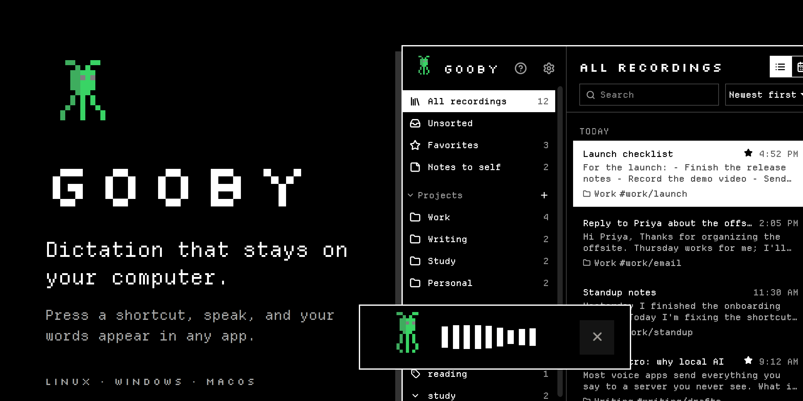
</p>

<p align="center">
  
  
  
  
  
</p>

<p align="center">
  <a href="https://github.com/gooby-app/releases/releases/latest"></a>
  <a href="https://github.com/gooby-app/releases/releases/latest"></a>
  <a href="#linux"></a>
</p>

<p align="center">
  <a href="#what-gooby-does">Features</a> ·
  <a href="#download">Download</a> ·
  <a href="#getting-started">Getting started</a> ·
  <a href="#faq">FAQ</a> ·
  <a href="CHANGELOG.md">What's new</a> ·
  <a href="PRIVACY.md">Privacy</a> ·
  <a href="TROUBLESHOOTING.md">Help</a>
</p>

> [!NOTE]
> Gooby is in **pre-alpha**. The first public release is on its way: click
> **Watch → Custom → Releases** at the top of this page to hear when it's out.

Gooby turns your voice into text in any app, and does it all on your own
computer. Press a shortcut, talk, press it again, and clean, punctuated text
appears where your cursor is: an email, a document, a chat, a code editor.
Speech recognition and AI formatting run locally, so what you say never
leaves your computer, and there's no account to make and no per-minute
pricing.

<p align="center">
  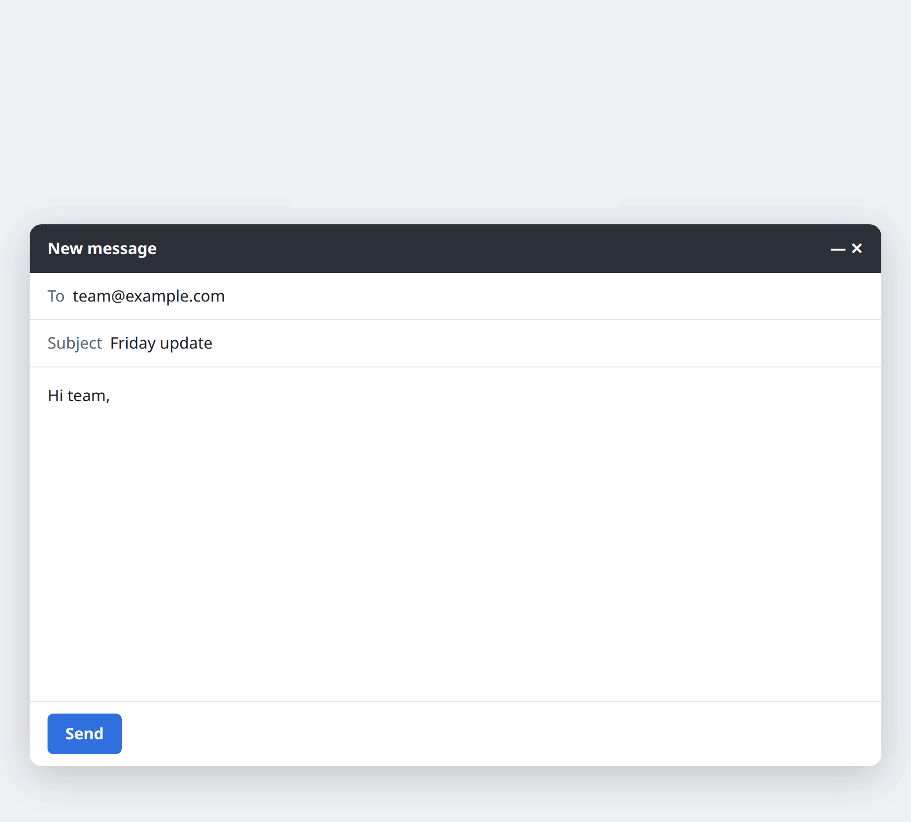
  <br>
  <sub>A real dictation into an email, recorded on Linux (the voice is text-to-speech). The overlay at the top<br>shows Gooby listening; the AI formatter turned the spoken steps into a numbered list.</sub>
</p>

## What Gooby does

- **Dictate into any app.** One shortcut, in any app that takes text. Hold it
  to talk, or tap to start and tap to stop.
- **Private by design.** Speech and formatting run on your computer. No
  account, no telemetry, no cloud unless you turn it on.
- **Clean text, not a transcript.** A built-in AI model fixes punctuation,
  drops the "um"s and turns spoken lists into real lists.
- **Talk to Gooby.** Start with "Gooby, …" to switch language or project, turn
  formatting off or keep a note to self.
- **A Library of everything you've said.** Every dictation with its audio:
  search it, star it, file it in projects and tags, see it on a calendar.
- **Set up in one click.** Gooby picks the speech model and AI formatter that
  suit your computer and finds your microphone.
- **Yours to style.** Light or dark, six two-color palettes, and text from
  Small to Largest.

### Dictate into any app

Put your cursor where the text should go, press **Ctrl+Alt+Space**
(**Option+Space** on a Mac) and speak. A small overlay shows Gooby listening;
press the shortcut again, or let go if you held it, and your words are typed
in. **Esc** throws a dictation away.

<p align="center">
  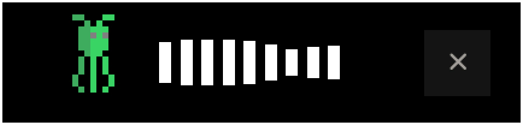
</p>

- **Works where you type:** email, documents, chat, browsers, terminals, code
  editors. Gooby types the text for you or pastes it, whichever works best
  in that app, and puts your clipboard back afterwards.
- **Names and words** you teach it ("Priya", "Kubernetes", your company's
  products) are spelled your way.
- **Didn't hear anything?** The overlay says so instead of typing nothing,
  and Gooby tells you if another app already holds your shortcut.
- **When typing isn't possible**, the text goes to the clipboard and the
  overlay tells you, so nothing you said is lost.

### Clean text, not a transcript

AI formatting tidies what you said before it's typed: punctuation and
capitals, no "um"s or false starts, and lists when you speak in steps. It runs
on a model built into Gooby (Gemma or Qwen, picked for your computer), so
nothing is sent anywhere. You can turn it off in Settings, or by voice:
"Gooby, formatting off".

<p align="center">
  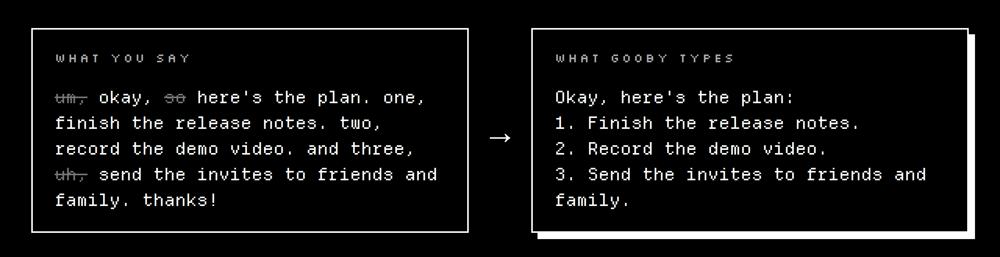
</p>

Prefer another model? Gooby also works with any OpenAI-compatible server on
your own computer (such as Ollama or LM Studio), Apple Intelligence on Macs,
and, only once you allow cloud providers, OpenAI, Anthropic, Groq, OpenRouter,
Cerebras, Z.AI and AWS Bedrock. API keys are kept in your system's password
store.

### Talk to Gooby

Start a dictation with "Gooby," to change things without opening Settings.
Anything Gooby doesn't recognize is typed as you said it.

<p align="center">
  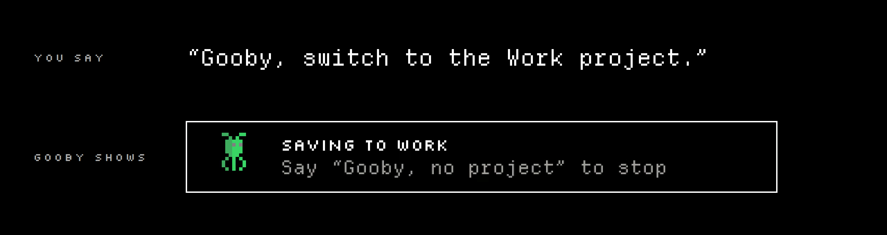
</p>

| Say | What happens |
|---|---|
| "Gooby, note: call the dentist" | Kept in the Library as a note to self; nothing is typed. "Note to self …" works too. |
| "… Gooby, cancel" | Throws this dictation away. "Never mind" and "scratch that" work too. |
| "Gooby, type that" | Types your last dictation where the cursor is. |
| "Gooby, formatting off" | Turns AI formatting off (or on again). |
| "Gooby, switch to French" | Dictate in another language; "auto-detect" goes back. |
| "Gooby, switch to the Acme project" | Files new dictations in Acme until "Gooby, no project". |
| "Gooby, open the Library" | Opens Gooby ("open settings" opens Settings). |

Dictating while Gooby's own window is in front, with no text box selected,
keeps the dictation as a note too.

### A Library of everything you've said

Every dictation is kept with its audio, so nothing you said is lost, even if
the app you were typing into wasn't ready.

<p align="center">
  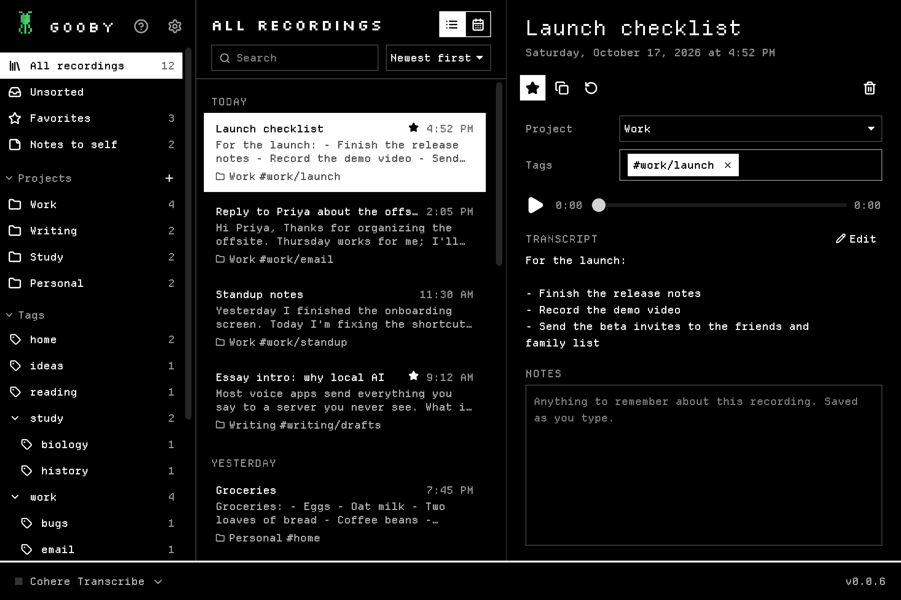
</p>

- **Projects, nested tags** (`work/acme`), **favorites** and **notes to
  self**, plus Unsorted and Recently Deleted (kept for 30 days).
- **Say where it goes:** start with "For the Acme project: …" or end with
  "… put it in Acme", and it's filed there with the command cut from the text.
- **Search** across titles, transcripts and notes; **drag and drop**
  recordings onto a project or tag, select several at once, and undo mistakes.
- **Live transcript:** words light up as the audio plays. Click one to jump
  there, fix mistakes in place, and "Teach Gooby" the right spelling.
- **Notes** on each recording, saved as you type.

| Calendar | Notes to self |
|---|---|
| 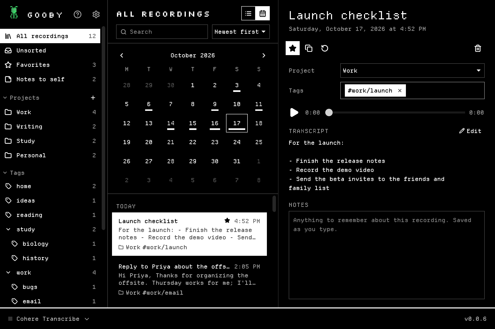 | 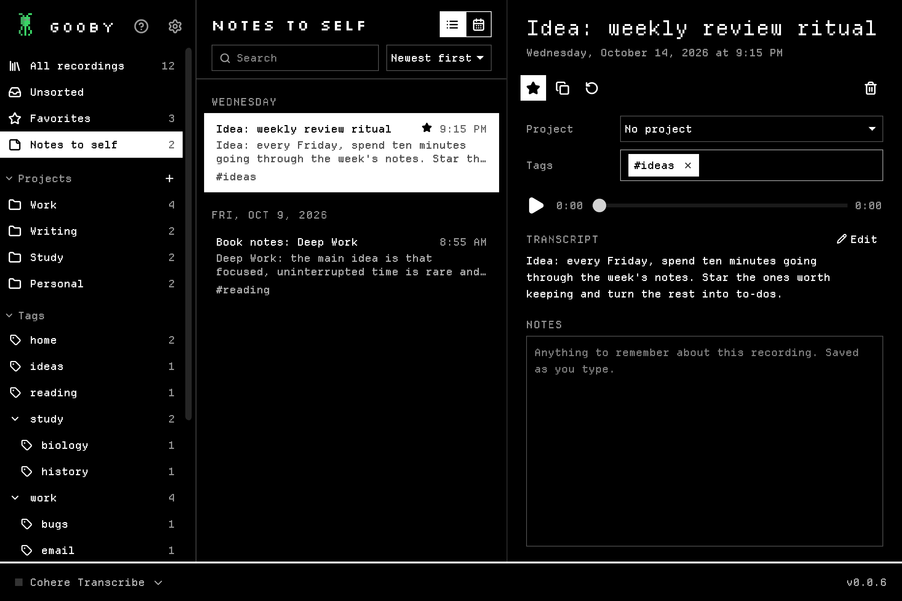 |

### Set up in one click

The first screen shows the speech model, AI formatter and microphone Gooby
picked for your computer. One click downloads them; you can dictate as soon as
speech is ready, and the formatter finishes in the background.

<p align="center">
  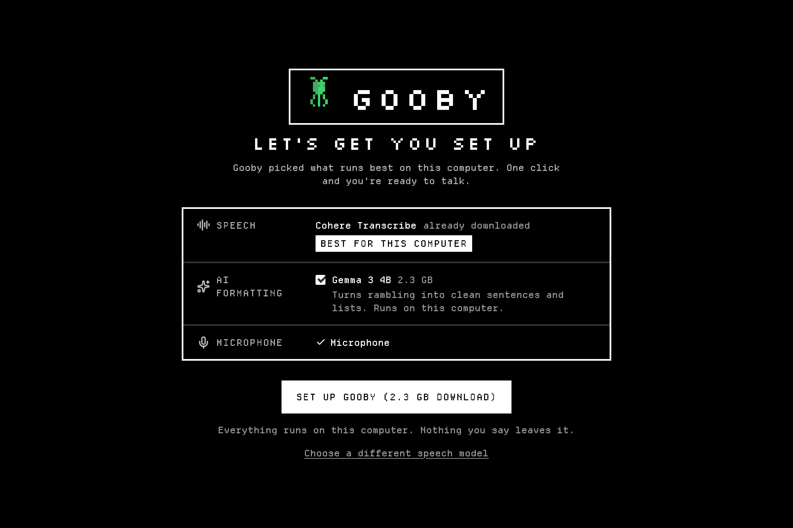
</p>

If your system's default input can't hear a voice (a digital S/PDIF input, a
loopback), Gooby switches to a real microphone and tells you. A microphone you
chose yourself always wins.

### The right model for your computer

Gooby rates every speech model for your memory and graphics card ("great",
"may be slow", "too large") and recommends the most accurate one that runs
well and speaks your language. Models use your graphics card when they can
(Vulkan on Windows and Linux, Metal on Macs) and your processor otherwise.

<p align="center">
  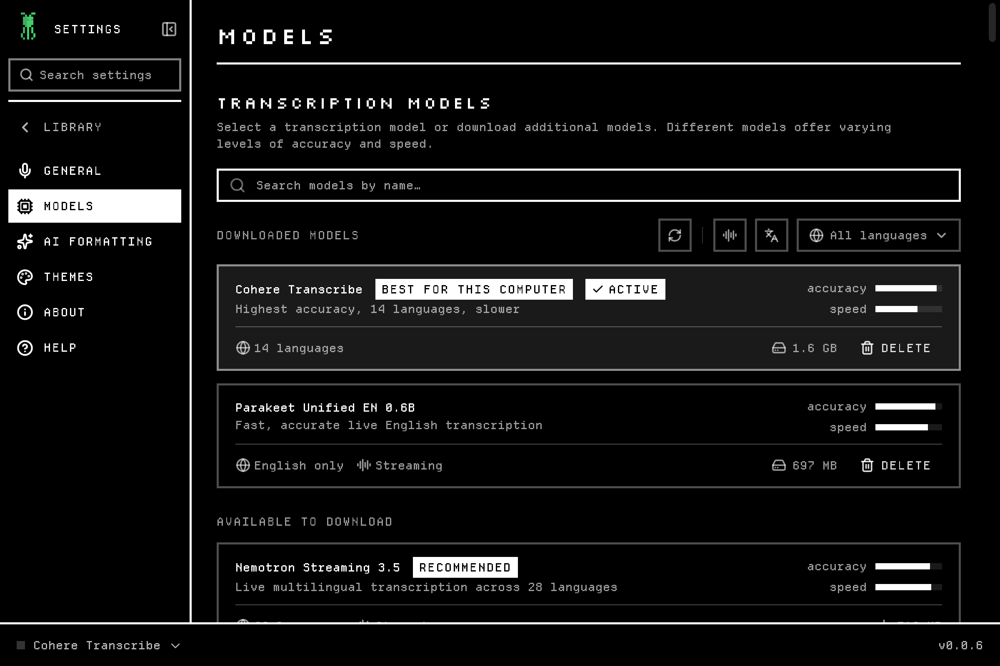
</p>

<details>
<summary><b>Speech models you can choose from</b></summary>

<br>

| Family | Good at | Languages | Download |
|---|---|---|---|
| **Parakeet** (NVIDIA) | Fast and accurate English; v3 covers 25 European languages | 1–25 | 85 MB – 790 MB |
| **Whisper** (OpenAI) | The widest language coverage | up to 100 | 40 MB – 950 MB |
| **Cohere Transcribe** | Top accuracy | 14 | 1.5 GB |
| **Canary** (NVIDIA) | Accurate and quick in English, German, Spanish and French | 4–25 | 130 MB – 1.7 GB |
| **Qwen3-ASR** | Many languages, including Chinese | 30 | 560 MB – 1.3 GB |
| **Nemotron Streaming** (NVIDIA) | Live, multilingual | 28 | 470 MB |
| **SenseVoice** | Chinese, Cantonese, Japanese, Korean, English | 5 | 140 MB |
| **Moonshine** | Tiny and very fast, for older computers | 1 each | 33 MB – 280 MB |
| **Granite Speech** (IBM), **Voxtral** (Mistral), **GigaAM** (Russian) and more | Specialists | varies | 170 MB – 13.6 GB |

Models are downloaded from their publishers (through Hugging Face or Handy's
mirror) and come with their own licenses.

</details>

<details>
<summary><b>AI formatting models</b></summary>

<br>

| Model | Download | Notes |
|---|---|---|
| Gemma 3 1B | 770 MB | English only, for computers without much memory |
| Qwen 2.5 1.5B | 1.0 GB | Many languages |
| Gemma 3 4B | 2.3 GB | The usual pick at setup |
| Gemma 3 12B | 6.8 GB | Best results; Gooby recommends it when your graphics card has room |

Setup downloads at most the 2.3 GB model; bigger ones are opt-in.

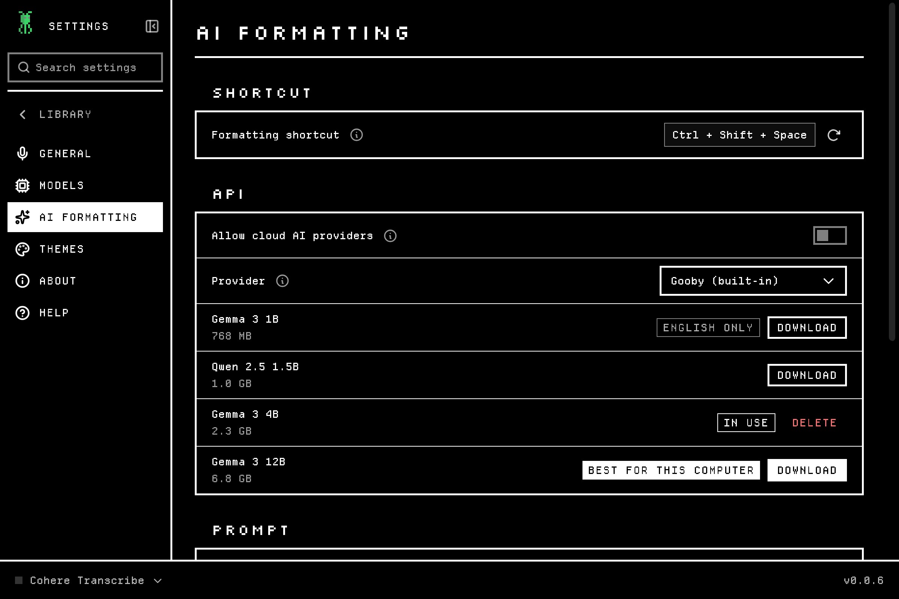

</details>

### Make it yours

Light or dark (or follow your system), six two-color palettes that also color
the overlay, and text from Small to Largest (**Ctrl/Cmd +** and **−**) that
follows your system's text size on Windows and GNOME.

<p align="center">
  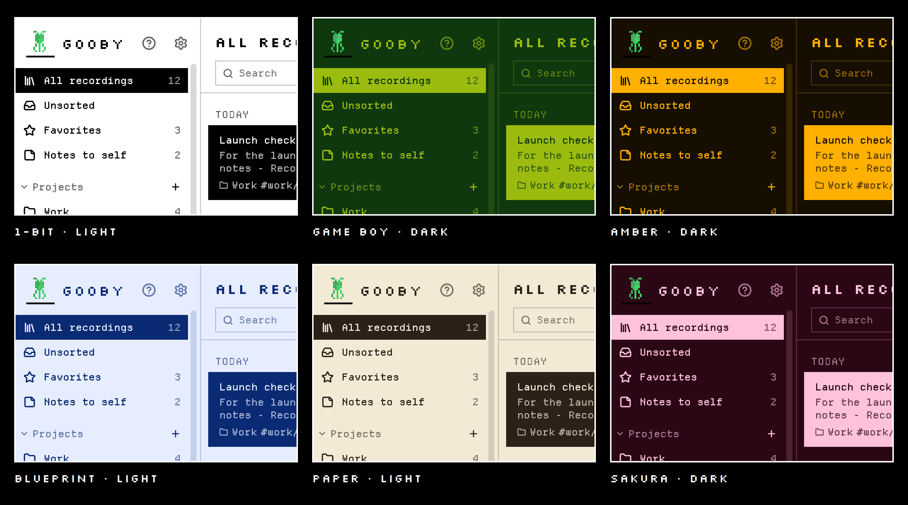
</p>

| Themes | Settings |
|---|---|
| 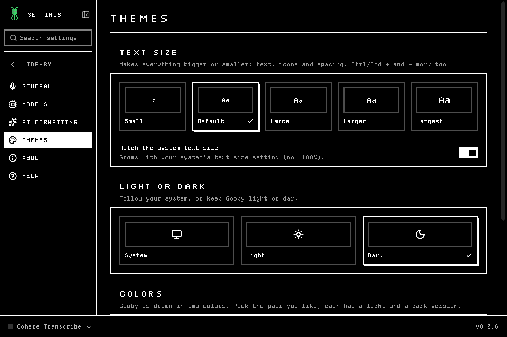 | 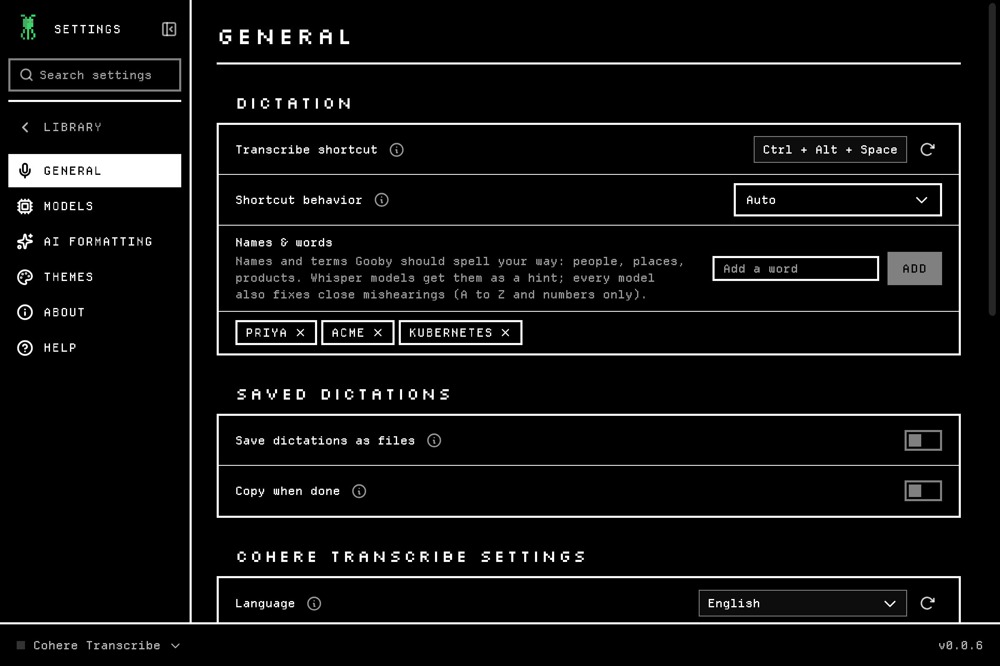 |

## What runs where

<p align="center">
  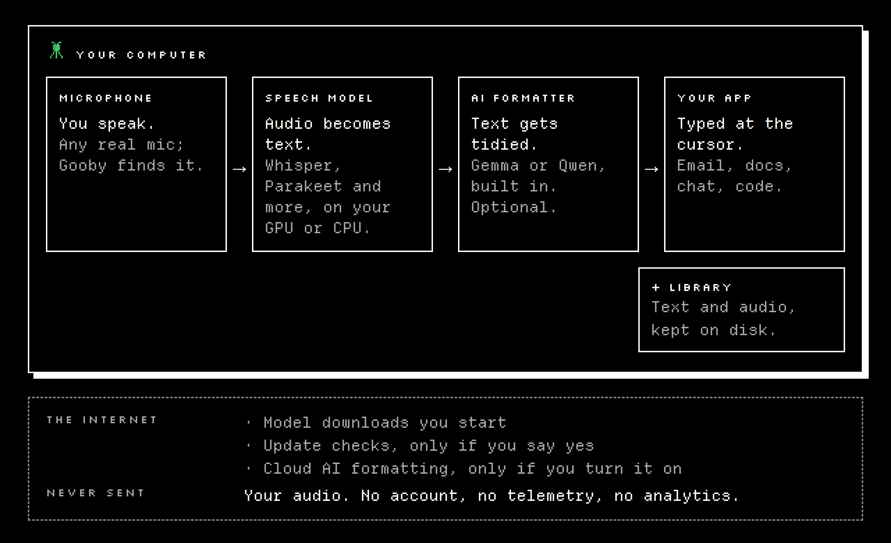
</p>

| | Where it happens |
|---|---|
| Recording your voice | Your computer |
| Speech to text | Your computer, with the model you picked |
| AI formatting | Your computer by default; a cloud provider only if you allow it and pick one |
| Your Library (text, audio, notes) | Files in Gooby's data folder on your computer |
| Model downloads | Hugging Face or Handy's mirror, only when you start one |
| Update checks | This page's releases, only if you said yes |

[PRIVACY.md](PRIVACY.md) lists every connection and every file Gooby keeps.

## Download

Get the installer for your system from the
[latest release](https://github.com/gooby-app/releases/releases/latest)
*(the first one is coming soon)*.

| System | File | Needs |
|---|---|---|
| **Windows** 10 and 11 (64-bit) | `Gooby_x.y.z_x64-setup.exe` | |
| **macOS**, Apple Silicon | `Gooby_x.y.z_aarch64.dmg` | macOS 11 or later |
| **macOS**, Intel | `Gooby_x.y.z_x64.dmg` | macOS 10.15 or later |
| **Linux** (64-bit): Ubuntu, Debian, Fedora, Arch and others | `Gooby_x.y.z_amd64.AppImage` or `Gooby_x.y.z_amd64.deb` | X11 or Wayland |

**Every system:** a microphone, and up to about 4 GB of disk space for the
models setup downloads. Gooby picks models that fit your memory, so it runs on
ordinary laptops; a graphics card makes it faster but isn't needed.

### Windows

Run the installer. Windows may show "Windows protected your PC" for a new
app: click **More info → Run anyway**.

### macOS

Open the `.dmg` and drag Gooby to Applications. Until the builds are signed by
Apple, macOS blocks the first launch: open Gooby once, then go to **System
Settings → Privacy & Security → Open Anyway**.

### Linux

One command, no sudo. It installs Gooby just for you, with an app-menu entry
and a `gooby` command, in a place where updates can replace it:

```bash
curl -fsSL https://raw.githubusercontent.com/gooby-app/releases/main/install-linux.sh | bash
```

Or install the `.deb` with `sudo apt install ./Gooby_x.y.z_amd64.deb`, or make
the AppImage executable (`chmod +x`) and run it.

## Getting started

1. **Open Gooby.** The setup screen shows what it picked for your computer.
   Click **Set up Gooby**.
2. **Allow what your system asks for:**
   - **macOS:** Microphone, and Accessibility (so Gooby can type for you).
   - **Windows:** if nothing is recorded, check that **Settings → Privacy &
     security → Microphone** lets desktop apps use it.
   - **Linux on Wayland:** your desktop asks once to let Gooby type into other
     apps. On KDE Plasma, GNOME 48+ and Hyprland it also asks to confirm
     Gooby's shortcut; on older GNOME, Settings → General shows how to add it
     as a system shortcut.
3. **Click into any text box, press the shortcut and talk.** Press it again
   to stop.

| Shortcut | Windows and Linux | macOS |
|---|---|---|
| Start and stop dictating | Ctrl+Alt+Space | Option+Space |
| Dictate with AI formatting, even when it's off | Ctrl+Shift+Space | Option+Shift+Space |
| Throw the current dictation away | Esc | Esc |
| Open or close Settings | Ctrl+, | Cmd+, |
| Search Settings | Ctrl+F | Cmd+F |
| Bigger, smaller, normal text | Ctrl + / − / 0 | Cmd + / − / 0 |

Every shortcut can be changed in Settings. Hold the dictation shortcut to talk
only while it's down, or tap it to start and stop; Settings → General can fix
it to one way.

## Updates

On first launch Gooby asks whether to keep itself up to date. If you say yes,
it downloads new versions in the background, checks their signature, and asks
before restarting (never mid-recording); "What's new" shows afterwards. If you
say no, nothing contacts the internet for updates, and you can download new
versions from this page.

## FAQ

<details>
<summary><b>Does Gooby work offline?</b></summary>

Yes. Once the models are downloaded, dictation and AI formatting work with no
internet connection at all.
</details>

<details>
<summary><b>Is my voice used to train anything?</b></summary>

No. Your audio and text stay in Gooby's folder on your computer. Gooby has no
servers to send them to, no account and no analytics.
</details>

<details>
<summary><b>What does it cost?</b></summary>

The first releases are for friends and family. The terms for users, including
any price, will be published here with the first release.
</details>

<details>
<summary><b>Do I need a graphics card?</b></summary>

No. Gooby rates every model for your computer and picks one that runs well on
what you have. A graphics card (NVIDIA, AMD or Intel through Vulkan, or any
Apple Silicon Mac) makes the bigger models fast.
</details>

<details>
<summary><b>Which languages does it understand?</b></summary>

Up to 100, depending on the speech model: Whisper covers the most, Parakeet v3
covers 25 European languages, and smaller models are English-only. Gooby's
recommendation takes your language into account. The app itself is translated
into 25 other languages (newer screens are English-only for now).
</details>

<details>
<summary><b>Does it work on Wayland?</b></summary>

Yes. Gooby types into native Wayland apps on GNOME and KDE through the desktop's
own remote-input permission (your desktop asks once), and registers its
shortcut with desktops that support it.
</details>

<details>
<summary><b>Can I use my own microphone or headset?</b></summary>

Yes. Gooby picks a real microphone at setup, and you can choose any input in
Settings. Your choice always wins over Gooby's pick.
</details>

<details>
<summary><b>Where are my recordings, and how do I delete them?</b></summary>

In Gooby's data folder (`~/.local/share/com.gooby.dictation` on Linux,
`%APPDATA%\com.gooby.dictation` on Windows, `~/Library/Application
Support/com.gooby.dictation` on macOS). Delete recordings in the Library, or
delete the folder to remove everything. Details in [PRIVACY.md](PRIVACY.md).
</details>

<details>
<summary><b>Why isn't the source code here?</b></summary>

Gooby's source code is private for now. This repository holds the installers,
release notes, user docs and the issue tracker. Gooby is built on open-source
software, credited below and in
[THIRD-PARTY-NOTICES.txt](THIRD-PARTY-NOTICES.txt).
</details>

## Coming next

Plans, not promises:

- **"Hey Gooby"**: an optional, on-device wake word (off unless you turn it on).
- **App-aware formatting**: email-style in your mail app, short in chat,
  exact in a code editor.
- **Voice editing**: select text and say "Gooby, make this shorter".
- **A second brain**: automatic titles, summaries and to-dos for each
  recording, and "what did I decide about pricing last week?" answered from
  your own Library.
- **Meetings and long audio**: import audio and video files, who said what,
  and meeting notes.
- **More languages**: mixed-language dictation, and speak in one language,
  type in another.

Have an idea? [Suggest it](https://github.com/gooby-app/releases/issues/new?template=feature_request.yml).

## Uninstall

<details>
<summary><b>Windows, macOS and Linux</b></summary>

- **Windows:** Settings → Apps → Installed apps → Gooby → Uninstall.
- **macOS:** drag Gooby from Applications to the Trash.
- **Linux:** if you used the one-command install,
  `curl -fsSL https://raw.githubusercontent.com/gooby-app/releases/main/install-linux.sh | bash -s -- --uninstall`;
  for the `.deb`, `sudo apt remove gooby`; for the AppImage, delete it.

Your recordings, settings and models stay on your computer until you delete
them; [PRIVACY.md](PRIVACY.md) lists where they are.
</details>

## Help and feedback

- **Something not working?** [TROUBLESHOOTING.md](TROUBLESHOOTING.md) covers
  known issues and fixes, and Settings → Help in the app has the common ones.
- **Found a bug?** [Report it](https://github.com/gooby-app/releases/issues/new?template=bug_report.yml).
  Settings → About → Log directory opens the folder with Gooby's logs;
  attaching the latest one helps a lot.
- **Have an idea?** [Suggest it](https://github.com/gooby-app/releases/issues/new?template=feature_request.yml).
- **Security problem?** Please report it privately, as [SECURITY.md](SECURITY.md)
  explains.

## License

Gooby's source code is private. Its license terms for users will be published
here with the first release.

Gooby includes open-source software; [THIRD-PARTY-NOTICES.txt](THIRD-PARTY-NOTICES.txt)
lists every component with its license, and the app shows the same list under
**Settings → About → Open-source licenses**. Speech and formatting models are
downloaded from their publishers and come with their own licenses.

## Credits

- **[Handy](https://github.com/cjpais/Handy)** by CJ Pais (MIT): Gooby began
  as a fork of it.
- **[ggml](https://github.com/ggml-org/ggml)** and
  **[llama.cpp](https://github.com/ggml-org/llama.cpp)** by Georgi Gerganov and
  contributors, and **[ONNX Runtime](https://onnxruntime.ai)** by Microsoft run
  the models on your computer.
- **Models** by NVIDIA, OpenAI, Cohere, Google, Alibaba (Qwen, FunAudioLLM),
  IBM, Mistral AI, Moonshine AI, SberDevices and others.
- **Fonts:** [Departure Mono](https://departuremono.com) by Helena Zhang and
  [Silkscreen](https://github.com/googlefonts/silkscreen) by Jason Kottke (SIL
  Open Font License).
- **Gooby sprite:** drawn using
  [this pixel-art piece](https://imgur.com/oc-newbie-working-on-pixel-people-spare-time-YLdUMUZ)
  as a reference; the original creator is unknown. If you know who made it,
  please open an issue so we can credit them.
